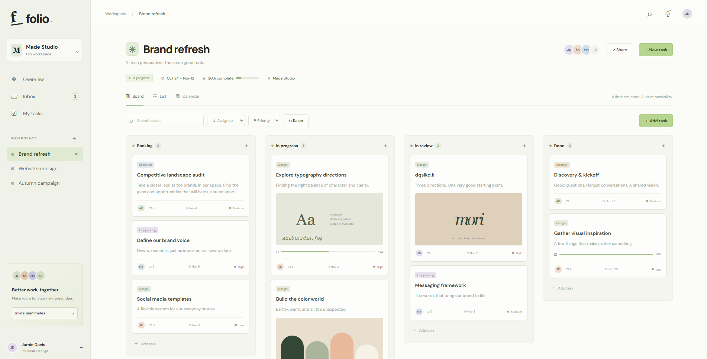
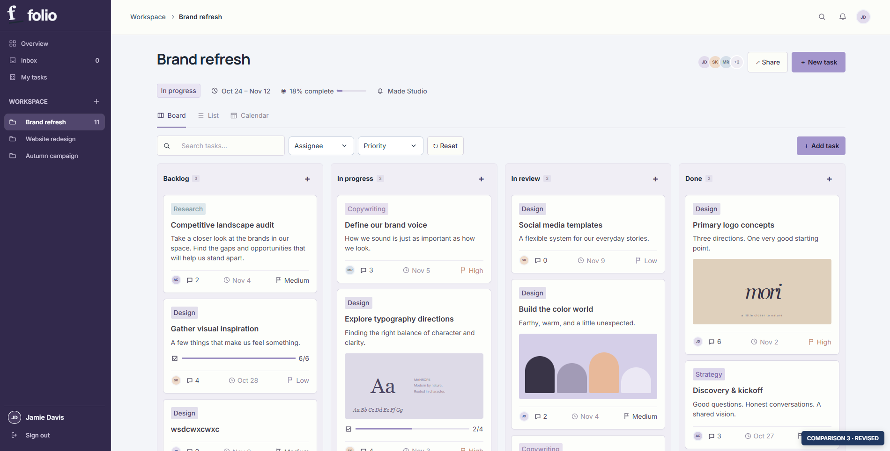

# Unslopify UI

AI can build a website in minutes. Getting one that doesn't look like every other AI website takes more work.

Unslopify UI gives AI assistants practical guidance for designing websites and web apps: typography, color, layouts, navigation, interactions, data, and mobile usability. Use it with an AI coding agent in your preferred IDE or terminal, or provide the guides to a chat assistant. The tool—not just the model—determines how instructions are discovered.

## Before and after

An example of applying the guidance to the same project dashboard.

**Before**



**After**



## Quick start

You need [Node.js](https://nodejs.org/) 18 or newer, npm, and Git. Open a terminal in **your own project's root**, then run:

```sh
npx --yes github:AyoubElleuch/unslopify-ui --init
```

This installs the guides and palette generator in `.unslopify-ui/`. It also creates missing `AGENTS.md`, `CLAUDE.md`, `GEMINI.md`, and `.github/copilot-instructions.md` files that point to the guides. Existing instruction files are left untouched; if one already exists, add this line to it yourself:

> For website and app design, read .unslopify-ui/guides/README.md and the relevant linked guides before implementing. Follow the user’s explicit instructions when they conflict with any Unslopify UI guideline; apply the remaining relevant guidelines.

Open the project in your IDE, start or restart the assistant session, and describe what you want to build. Include the product's purpose, audience, features, and any visual preferences. For example:

> Build a responsive booking dashboard for a photography studio. Use the Unslopify UI guides in .unslopify-ui/guides/README.md. My primary color is #2E4057. Keep the existing app's framework and functionality.

The installer works from the GitHub repository once these files have been pushed. The command downloads code from GitHub and runs it locally; review the repository or pin a trusted release/commit when reproducibility matters. No npm registry publication is required. This project does not claim that a published npm package exists.

## Which assistant reads what?

| Tool | Project instruction file |
| --- | --- |
| Codex, Grok Build, Kimi Code CLI, Cursor Agent | `AGENTS.md` |
| Claude Code | `CLAUDE.md` |
| Gemini CLI | `GEMINI.md` |
| GitHub Copilot | `.github/copilot-instructions.md`; supported instruction types vary by client |
| Other assistants | Provide the guide index explicitly, or configure the tool's project instructions. |

Support varies by tool, IDE, version, settings, and working directory. The short entry files ask the assistant to read the index; linked guides are not guaranteed to be loaded automatically. Ask your assistant which files it read, and review the result. The person using the assistant has the final say over these design defaults: when an explicit request conflicts with a guideline, follow the request and continue applying the other relevant guidelines.

## Other ways to use it

- **One task, no instruction files:** Run the same command without `--init`, then ask the assistant to read `.unslopify-ui/guides/README.md` and the relevant guides. The installer will not create agent entry files.
- **Chat or an IDE that cannot access local files:** Open the [guidance index](guides/README.md) and provide the relevant topic guides as attachments, pasted text, or accessible links. A link alone works only if the assistant can actually open it; verify what it read.
- **Existing instruction files:** The installer never overwrites them. Add the instruction above to the file used by your tool. In a team project, review and commit the installed files if the team wants to share them, or keep them local.
- **Update or remove:** The installer refuses to replace an existing `.unslopify-ui/` directory. Back up any edits, remove or rename that directory yourself, and run the command again to install the current version. To remove it, delete that directory and manually remove any references or instruction files you added. Existing instruction files are not modified by the installer.

## Generate a palette

From the project where you installed the guide:

```sh
node .unslopify-ui/color/palette.js "#2E4057" analogous
```

A primary color gives the clearest starting point, but you can also supply a reference color. The generator produces candidate ranges, not a finished design; check colors in context. See the [palette guide](color/README.md) for options and limitations.

## Explore the guidance

The [design guidance index](guides/README.md) links to focused guides. The [design notes](DESIGN-NOTES.md) record interface issues and preferences collected during development.

## Contributing

This is an early version, and there is much more to come. Contributions, suggestions, and feedback are appreciated.

## License

[MIT](LICENSE).
